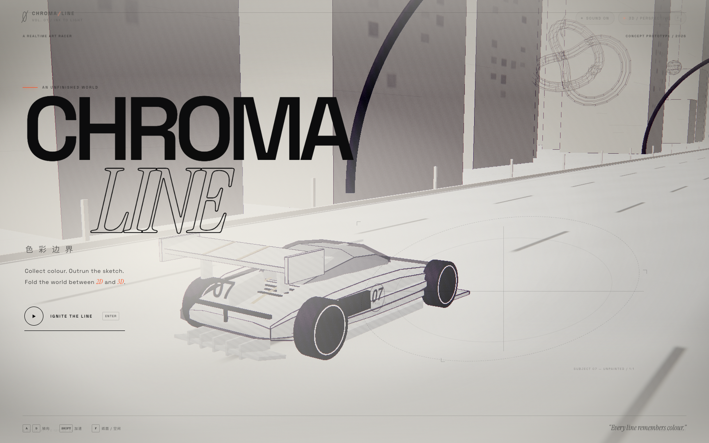
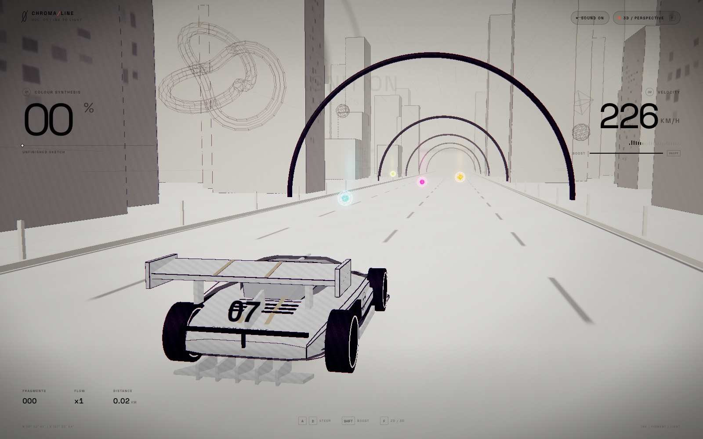
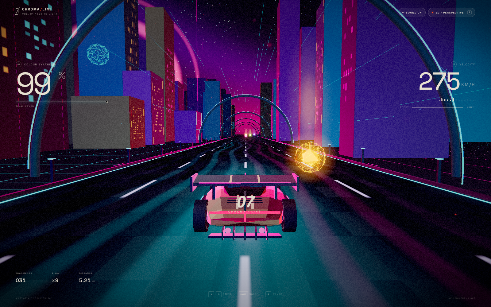
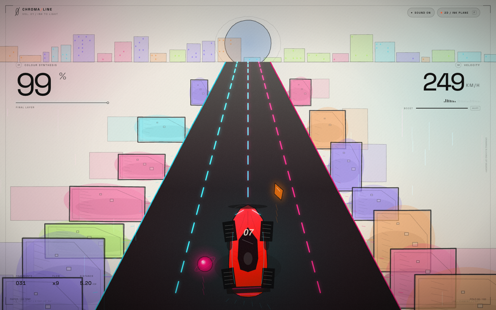

# CHROMA / LINE — 色彩边界

> An unfinished sketch world. A car made of lines. Collect colour, outrun the sketch, and fold reality between **2D** and **3D**.

**CHROMA / LINE** is a playable realtime art-racing concept built with Three.js, Canvas 2D and custom GLSL. The run begins inside a monochrome hand-drawn city. Every pigment orb and colour shard the player collects is absorbed into the car and the world: paper facades acquire material depth and neon windows, the road turns to wet asphalt, the sky becomes a cyber-cinematic night, and the sketch becomes a full-colour machine.

Press **F** at any time to fold between the 3D perspective world and the 2D ink plane. The transition is a piece of theatre: paper shards, a rotating page, re-registering ink lines, camera whip, shockwave, chromatic aberration, and a car that leaps from the flat drawing back into space.

---

## Run it

```bash
cd chroma-line
npm install
npm run dev
```

Open **http://localhost:4173** (or the port shown by Vite).

Production build:

```bash
npm run build
npm run preview
```

Requires a modern browser with WebGL2. Best experienced fullscreen with sound on.

## Deploy on Vercel

This is a pure static Vite site: no server, database, or environment variables are required.

1. Push the repository to GitHub.
2. Go to [vercel.com/new](https://vercel.com/new) and import `lanyugod/chroma-line`.
3. Keep the detected settings: framework **Vite**, build command **`npm run build`**, output directory **`dist`**.
4. Click **Deploy**.

The included [`vercel.json`](vercel.json) already pins the build command and output directory. CLI alternative:

```bash
npx vercel login
npx vercel --prod
```

## Controls

| Input | Action |
| --- | --- |
| `A` / `D` or `←` / `→` | Steer |
| `Shift` | Boost |
| `F` | Fold between 3D and 2D ink mode |
| `Enter` | Ignite the line |
| `Esc` | Pause |
| `M` | Mute / unmute |
| `R` | Restart after completion |

On touch devices, on-screen steering and boost controls appear. The mode chip in the top-right also switches dimensions.

## What is in the build

- **Custom low-poly hypercar** (`src/car.js`) assembled from lofted body sections, aero, side contours, carbon trim, wheels and a rear number plate. A GLSL paint layer reveals colour from a moving ink boundary, adds clearcoat/fresnel highlights and fades hand-drawn hatching as the car becomes real.
- **Living sketch city** (`src/world.js`): procedural buildings with ink window grids, neon facade edges, arches, monorail-like light rails, wireframe specimens, speed streaks and drifting pigment dust. Materials, fog, lighting and the GLSL sky interpolate with colour progress.
- **Collectibles** (`src/collectibles.js`): pooled pigment orbs and glowing shards with beams, halos, orbit rings, particle bursts and shock halos.
- **2D ink plane** (`src/ink2d.js`): a complete hand-drawn top-down world rendered to Canvas 2D — procedural city blocks with watercolour fill, perspective road, sketched car, splashes, speed lines and paper grain. It shares the same simulation and steering as the 3D world.
- **Fold ritual** (`src/ritual.js` + CSS): re-registering ink lines, collapsing polygons, paper shards, page rotation and the 2D→3D car leap.
- **Post FX** (`src/post.js`): UnrealBloom, paper grain, chromatic aberration, radial speed smear, filmic grade, fold shockwave, flash and vignette.
- **Procedural audio** (`src/audio.js`): synthesised engine, wind, collect arpeggios, fold whoosh and completion chord. No audio files.

## Preview frames

| | |
| --- | --- |
|  |  |
|  |  |

More frames are in [`preview/`](preview/).

## Project structure

```
chroma-line/
  index.html
  src/
    main.js          entry point
    game.js          state, input, camera, progression, UI
    world.js         city, road, sky, lights, pickups scene dressing
    car.js           procedural hypercar + paint shader
    collectibles.js  pooled pickups and particles
    ink2d.js         Canvas 2D ink plane
    ritual.js        fold transition line overlay
    post.js          post-processing stack
    audio.js         procedural WebAudio soundscape
    style.css        editorial UI, paper fold, responsive layout
  preview/           captured concept frames
```

## Notes

- The world uses metre-like units; the HUD speed is a stylised conversion.
- Collecting colour is deterministic in simulation but spawn patterns are procedural, so each run has a different rhythm.
- Headless screenshot capture uses software WebGL; real hardware rendering is substantially smoother.
